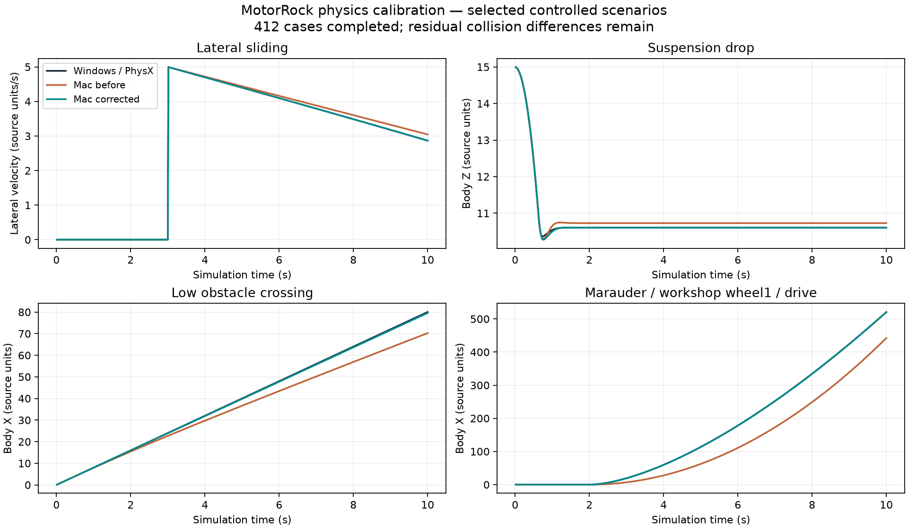

# Сверка физики MotorRock: Windows PhysX → Mac Jolt

Завершено 412 одинаковых сценариев; 230,400 завершённых шагов на платформу. Частота 60 Гц. Эталон собран из исходного PhysX 2.8.4 SDK внутри Windows 11 / Parallels.

17 исходных машин; 35 вариантов колёс и 15 других положительных функций шин из мастерской. Дополнительно проверены массы, силы, импульсы, вращение, подвеска, тормоза, уклоны, масло, предел сцепления, препятствия и воздушные модификаторы. Команды задаются напрямую в Nm/колесо.

| Группа | Сценарии | RMS позиции до → после | RMS скорости до → после |
|---|---:|---:|---:|
| synthetic | 60 | 1.84667 → 0.417422 | 0.521402 → 0.177233 |
| chassis | 102 | 1.69662 → 0.166282 | 0.737603 → 0.353744 |
| workshop | 250 | 42.332 → 0.229638 | 13.041 → 0.355637 |
| all | 412 | 34.1721 → 0.247766 | 10.5299 → 0.338938 |

## Что исправлено

- Композитный тензор инерции кузова с массой колёс и восстановлением исходного COM; проверка всех 17 машин независимыми числами Nx SDK.
- Grounded axle speed пересчитывается из скорости точки контакта каждый шаг. Тяга применяется по исходной кривой шины без обратной реакции вращения колеса; restTorque сохранён.
- Предсказание скорости для бокового угла скольжения учитывает нормальную скорость и гравитацию. Динамическая кривая используется и для малых ненулевых скольжений.
- Радиус учитывается в начале луча подвески; допустимо отрицательное положение оси. Преобразование жёсткости пружины проверено на всей матрице.
- Контактная геометрия учитывает skinWidth; инерция рассчитывается по исходным размерам.
- Угловая скорость ограничивается после демпфирования; extra gravity, airborne pitch, локальный угловой момент и ограничения позы проверены по Nx.

## Оставшиеся различия

Полной идентичности двух решателей пока нет. Ниже самые большие остаточные ошибки; среднее по всем тестам не означает, что каждый тест совпал. Synthetic target-half проверяет ненулевой suspensionTarget; по фактическому Nx SDK его rest offset задаётся в единицах мира. У исходных машин targetValue=0. ИИ, все комбинации мастерской, полные карты и все столкновения оружия этой матрицей не сертифицированы.

| Сценарий | RMS позиции | RMS скорости | RMS вращения, рад |
|---|---:|---:|---:|
| com-forward | 1.95798 | 0.37068 | 0.00567464 |
| wall-hit | 1.50075 | 0.507855 | 0.164685 |
| wall-oblique | 1.201 | 0.492766 | 0.145112 |
| mobility/xCar/engine1/wheel-drive | 0.940026 | 0.32604 | 0.0233265 |
| mobility/xCar/engine2/wheel-drive | 0.907587 | 0.314209 | 0.0233 |
| mobility/xCar/engine3/wheel-drive | 0.876625 | 0.303118 | 0.0232774 |
| mobility/mustang/wheel3/wheel-drive | 0.692751 | 0.549827 | 0.0611361 |
| mobility/podushka/engine1/wheel-drive | 0.613183 | 0.252677 | 0.00240679 |
| mobility/podushkaBoss/engine1/wheel-drive | 0.613183 | 0.252677 | 0.00240679 |
| mobility/podushka/engine2/wheel-drive | 0.595408 | 0.247031 | 0.00235658 |

Полные метрики и конечные состояния каждого сценария: [архив отчёта и CSV](https://github.com/dmitrcher/rrr3d/releases/tag/physics-source-parity-2026-10-10). Исходные единицы игры, секунды и радианы.

## Проверка сборки и обычной игры

37 CTest и 12 Python-проверок прошли. Отдельные oracle-проверки: инерция всех 17 машин по числам Nx и фактический импульс кузова по изменению линейного момента.

Повторные 13 базовых сценариев / 5400 шагов дали нулевое расхождение внутри каждой платформы по позиции, скорости, вращению и угловому моменту. Это проверка повторяемости стенда; она не доказывает идентичность ИИ.

Physics smoke исходной игры прошёл. Гонки Metal на трассах 0, 16 и 48 прошли 600 кадров с шестью машинами. На трассе 64 600-кадровая проверка выживания не прошла: журнал показывает три попадания оружия (40, 18, 27 урона), типы Simple/Mine, от соперников 1 и 4. Игрок погиб; эта проверка не объявляется успешной. Граф рендера и колёсные контакты были исправны. Проверка не заменяет сравнение такой же гонки с Windows.

Подробный отчёт — [GitHub release](https://github.com/dmitrcher/rrr3d/releases/tag/physics-source-parity-2026-10-10). В архив включены все завершённые трассы, per-case метрики, CSV, графики, SHA и журналы с результатами, включая неуспешный тест.

