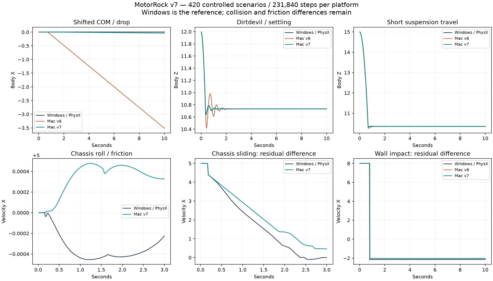

# MotorRock: сверка физики v7, 11 октября 2026

**Цель устранения всех расхождений активна и не достигнута.** Windows/PhysX остаётся эталоном. Оба стенда завершили 420 сценариев / 231 840 шагов с одинаковыми входами при 60 Гц.

## Исправления

- Ограничитель сжатия колёс перенесён как `radius - sceneSlop`, где sceneSlop=0.05. Ранее Jolt позволял сжатие до −radius; это вызывало преждевременный удар кузова и продольный дрейф.
- Нулевая жёсткость подвески разрешена; нулевая пружина с нулевым амортизатором выключает мягкую связь, сохраняя механический ограничитель. Отдельный амортизатор использует мягкую связь.
- Моменты инерции привязаны к исходным осям по собственным векторам. Предположение о наименьшей инерции X удалено. Независимый Nx-оракул проверяет 17 штатных машин и дополнительную геометрию.
- Направления трения используют нормализованную проекцию, измеренный в SDK порог 0.01 и усреднение U/V у полюса. Сохранены сырые данные 11 независимых полярных проб.

## Результат на прежних 412 сценариях

| Взвешенный RMS по всем шагам | v6 | v7 | Улучшены / без роста |
|---|---:|---:|---:|
| Положение | 0.24776646 | 0.17464433 | 393/412 |
| Скорость | 0.33893842 | 0.13993622 | 409/412 |
| Вращение, рад | 0.013011528 | 0.012615788 | 387/412 |
| Ход подвески | 0.018785572 | 0.0057610043 | 410/412 |

Windows повторил все 412 прежних сценариев **без единого изменения sample-данных**. Новые 8 сценариев опубликованы отдельно в полной матрице; они не добавлены к старому среднему для создания видимости улучшения.

| Контрольный сценарий | RMS положения v6 | RMS положения v7 |
|---|---:|---:|
| com-forward | 1.9579775 | 0.023116388 |
| travel-short | 0.4501278 | 0.0046672 |
| suspension-drop | 0.045947708 | 0.0025233691 |
| dirtdevil/settle | 0.46843705 | 0.0018036076 |

## Проверки и ограничения

- 38 CTest-проверок и 14 Python-проверок прошли, включая независимые численные оракулы инерции, ограничителя подвески и равенства импульса кузова изменению линейного момента.
- Повторные 13 базовых сценариев проверяются отдельно на каждой платформе; результаты и SHA файлов включены в архив аудита.
- Игровые проверки физики и гонки по 600 кадров на трассах 0, 16, 48 прошли. На трассе 64 survival-проверка завершилась гибелью игрока от исходного оружия соперников: 40 + 18 + 9 + 27 damage, типы Simple/Mine; журнал с причинами сохранён.
- Графические smoke-проверки не доказывают равенство пикселей Windows и Mac. Стенд задаёт моменты напрямую и обходит коробку и ИИ; отдельные функции мастерской не покрывают все комбинации слотов.

## Незавершённые расхождения

Строгий `--require-exact` возвращает код 1: наблюдаемые различия остаются в 412/420 сценариях, включая малые численные отклонения. Обычное завершение сборки/сверки не помечает физику совпадающей.

| Наибольшие RMS положения v7 | Положение | Скорость | Вращение, рад |
|---|---:|---:|---:|
| wall-hit | 1.5007539 | 0.50785473 | 0.16468472 |
| wall-oblique | 1.2009999 | 0.49276641 | 0.14511151 |
| mobility/xCar/engine1/wheel-drive | 0.94002569 | 0.32604 | 0.023326516 |
| mobility/xCar/engine2/wheel-drive | 0.90758699 | 0.31420874 | 0.023299994 |
| mobility/xCar/engine3/wheel-drive | 0.87662492 | 0.30311755 | 0.02327736 |
| body-slide-diagonal | 0.81145174 | 0.52596832 | 0.43516198 |
| body-slide-x | 0.70978119 | 0.53104662 | 1.0789449 |
| mobility/mustang/wheel3/wheel-drive | 0.68690326 | 0.35879882 | 0.06001197 |
| mobility/podushka/engine1/wheel-drive | 0.61295354 | 0.25203103 | 0.0023054498 |
| mobility/podushkaBoss/engine1/wheel-drive | 0.61295354 | 0.25203103 | 0.0023054498 |

В 19 прежних сценариях RMS положения вырос. Наибольший рост — manticora / manticoraBoss с wheel2/wheel3 (около 0.113 → 0.220); эти случаи остаются в очереди вместе со стенами и трением опрокинутого кузова. Среднее улучшение не заменяет проверку каждого сценария.

Следующий этап: время начала столкновения и skin-контакты со стенами, распределение касательных импульсов по точкам кузова, затем дрейф высокоскоростных вариантов мастерской. После каждого изменения повторяется затронутая группа и полная матрица.

Данные, оба стенда и сборка: [GitHub prerelease v7](https://github.com/dmitrcher/rrr3d/releases/tag/physics-parity-v7-2026-10-11).
