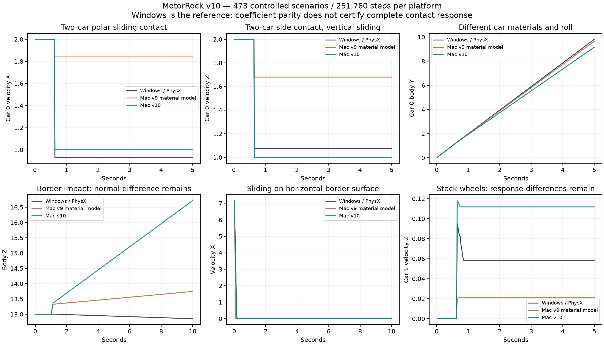

# MotorRock: контакты двух машин и бордюры v10, 11 октября 2026

**Цель устранения всех расхождений активна и не достигнута.** Windows / PhysX 2.8.4 остаётся эталоном. Матрица: 473 сценария / 251 760 шагов на платформу.

## Подтверждённое правило SDK

- 26 независимых проб материалов повторены с исходными четырьмя колёсами, настройками сцены Z-up/variable step, skin .025, adaptive force=0, solver iterations=4 и общими handles материалов. Сырые материалы и callback-коэффициенты опубликованы в tools/calibration/probes.
- SDK выбирает направление материала с большей величиной |V-U|. При равных величинах измеренная пара сохраняет порядок первого созданного актора. Второй анизотропный материал учитывается через среднее U/V.
- Вторичный коэффициент ограничивается 1 до полярного усреднения. Getter V=2 остаётся исходным; callback двух кузовов .08/2 получает [.08,1] сбоку и [.54,.54] у полюса. Первичный коэффициент может превышать 1.
- Для исходного MAX-материала бордюра dynamic=4 вторичный коэффициент равен 1 сбоку и 2.5 у полюса; GameCar затем обнуляет первичное направление. Mac повторяет эти коэффициенты.
- Новый physx_material_pairs принимает строго 0/1. Профили v6/v7/v8/v9 явно отключают модель; управляющие силы и прежние 435 сценариев не изменились.

## Расширение проверки

- Добавлены 34 сценария двух автомобилей: одинаковые/разные материалы, масса второго актора, наклон, встречный и косой удар, боковое вертикальное скольжение, полярный контакт, исходные колёса и фиксация вращения. Оба автомобиля наблюдаются отдельными сценариями.
- Добавлены четыре сценария бордюра. Вертикальная плоскость имеет исходную нормаль +X и проверяет заход со стороны -X; различия контакта обратной стороны сохраняются. Нормаль/касательная одного такого контакта Mac отличается от SDK.
- Списки list: теперь отвергают неизвестные, повторённые и пустые элементы до очистки журнала. Проверено на Mac и Windows, существующий файл сохраняется.

## Измерения

Все samples прежних 435 сценариев Windows и Mac сохранились точно. Средние новой матрицы не выдаются за сравнение с прежней: расширение добавляет ранее непокрытые ошибки.

| Взвешенный RMS на новых 38 сценариях | Модель v9 | v10 |
|---|---:|---:|
| Положение | 2.3505634 | 1.3187065 |
| Скорость | 0.55153975 | 0.34356768 |
| Вращение, рад | 0.49663406 | 0.47659267 |
| Подвеска | 0.0068896467 | 0.0068566346 |

| Сценарий | RMS положения модели v9 | RMS положения v10 |
|---|---:|---:|
| pair-pole-oblique-0 | 2.1616139 | 0.2193941 |
| pair-vertical-locked-0 | 1.4252154 | 0.18587688 |
| pair-vertical-weak-peer-0 | 1.3262295 | 0.72400121 |
| pair-weak-second-0 | 0.66217855 | 0.35862231 |
| pair-weak-first-0 | 0.35881793 | 0.37977182 |
| pair-stock-weak-second-1 | 0.38604526 | 0.38720504 |
| border-air-oblique | 9.3939046 | 4.2688363 |
| border-grounded | 1.1952977 | 0.36942601 |
| border-pole | 0.24421577 | 0.0036458382 |



## Проверки и открытые ошибки

- 41 CTest и 15 Python проверок прошли. Исправленные SDK-параметры также закреплены независимыми численными оракулами в physics smoke.
- Повторы 38 новых сценариев каждой платформы воспроизвелись точно. Окончательный Mac-прогон совпал с предварительными 469 сценариями, а предыдущие 435 сохранили каждый sample. Профиль v9 воспроизвёл 13 core-сценариев.
- 11 сценариев установленной Mac-сборки совпали с окончательной матрицей; подписи codesign проверены. Журнал manifold не изменил samples восьми сценариев.
- Коэффициенты всех восьми контрольных контактов совпали с SDK с погрешностью журнала менее 1e-6; касательные семи совпали по оси. У border-air-oblique направление осталось несовпадающим. Коэффициенты не доказывают равенство всего manifold или отдачи.
- Строгая сверка оставляет 465/473 сценария с различиями, включая малые числа. exact_parity.complete=false.
- При парном прямом ударе с фиксированным вращением оба движка начинают реакцию на tick 38. Windows затем даёт скорость [3.94980741,-0.00162954349,-0.283618897], Mac [4,0,0]. Инерция SDK raised-wheel fixture [2619912.75,2620586,1388.91931] сохраняется; причина поперечной реакции не установлена.
- Нормаль обратной стороны вертикального бордюра: SDK [-1,0,0], Jolt около [0,-0.28735,0.95783] в первом входном manifold. Оба начинают на tick 61. Это отдельная геометрическая/solver-ошибка; совпадение коэффициента 1 её не устраняет.
- pair-weak-first RMS положения 0.35882→0.37977; pair-stock-weak-second-1 RMS угла 0.95122→1.02643. border-grounded RMS скорости 0.37768→0.38092. Все регрессии перечислены по полям в JSON.
- Сверка также выдаёт RMS/максимум отдельно по X/Y/Z положения, скорости и углового момента: средний вектор не скрывает ухудшение отдельной оси. У border-air-oblique RMS Z положения вырос с 0.593115 до 2.208062, хотя общая ошибка положения снизилась. Это открытая регрессия.
- Остаются прежние переходные ошибки подвески, медленных воздушных ударов, скольжения/вращения кузова и высокоскоростных вариантов. Не покрыты все комбинации мастерской, ИИ, полные карты, оружие и равенство пикселей.

## Игровые проверки

```text
physics 0
track0 0
track16 0
track48 0
track64 1
```

Первый прогон трассы 48 завершился после 41 кадра с сообщением об отсутствующем ресурсе; он совпал по времени с перепаковкой приложения. Его журнал сохранён. Проверка на завершённом bundle и отдельный диагностический повтор прошли 600 кадров. Это не скрывает первый неуспех и не доказывает причину прерывания.

На трассе 64 проверка выживания не прошла. В seed=42 игрок получил урон оружия 40,18,18: life 70→30→12→−6. PhysicalTouch (3) и DeathPlane (4) среди повреждений игрока отсутствуют. Исходные правила урона сохранены.

[Сборка и полный аудит v10](https://github.com/dmitrcher/rrr3d/releases/tag/physics-parity-v10-2026-10-11).
