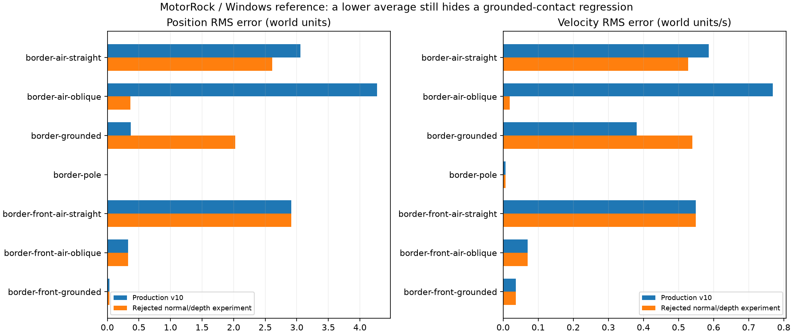

# MotorRock: аудит контактной ориентации v11, 11 октября 2026

**Цель устранения всех расхождений активна и не достигнута.** Эталон — Windows / PhysX 2.8.4. Рабочая физическая модель остаётся v10; оба исследованных изменения решателя отклонены из-за регрессий.

## Рабочие изменения

- Матрица выросла до 476 сценариев / 253 560 шагов. Три border-front-* сценария обращают порядок вершин того же вертикального бордюра; прежние проверки обратной стороны сохранены.
- Windows журнал callback теперь содержит constraint_error, constraint_target и static_friction0/1. Это реальные значения SDK, а не расчётные коэффициенты.
- Mac при RRR3D_CONTACT_POINTS=1 записывает геометрическую нормаль треугольника, рассчитанную ориентацию исходного GameCar, применение fallback и разделение каждой пары контактных точек. Эти поля не меняют силу или нормаль решателя.
- Source frame в Mac-журнале следует конвенции Jolt: нормаль от первого тела к второму. Nx axis0 имеет противоположную ориентацию в сравниваемых контактах; сравнивайте после преобразования соглашения, а не по несогласованным знакам.

## Отклонённая замена контактной ориентации

Эксперимент воспроизводил cross/fallback из GameCar::OnContactModify после расчёта коэффициентов по исходной нормали. Второй вариант сохранял исходную глубину проникновения отдельно от изменённой нормали в новых и кэшированных ограничениях. Экспериментальный SDK и адаптер сохранены в архиве аудита; в рабочую сборку они не включены.

| RMS на общих 473 сценариях | v10 | Ориентация + сохранение глубины |
|---|---:|---:|
| Положение | 0.3425332 | 0.27849862 |
| Скорость | 0.15373168 | 0.14972055 |
| Угол, рад | 0.12366891 | 0.11767347 |
| Подвеска | 0.0056961347 | 0.0055692272 |

Меньшее среднее не считается исправлением всех случаев. Например:

| Сценарий | RMS положения v10 | Эксперимент |
|---|---:|---:|
| border-air-oblique | 4.2688363 | 0.36574224 |
| border-grounded | 0.36942601 | 2.0257327 |
| border-front-air-straight | 2.9113247 | 2.9113247 |
| border-front-air-oblique | 0.32953532 | 0.32953532 |
| border-front-grounded | 0.036057828 | 0.036058337 |



## Статическое и динамическое трение

Полные журналы SDK подтверждают разные пределы. Динамический cap вторичного коэффициента в v10 не относится к статическому пределу. Значения до обнуления первичного направления GameCar:

| Пара | Статические U/V | Динамические U/V |
|---|---|---|
| Два кузова, боковой контакт | .08 / 1.64 | .08 / 1 |
| Два кузова, полярный контакт | .86 / .86 | .54 / .54 |
| Бордюр, боковой контакт | 4 / 3.2 | 4 / 1 |
| Бордюр, полярный контакт | 3.6 / 3.6 | 2.5 / 2.5 |

Отдельный эксперимент включал статический предел только если свободный касательный импульс помещался в этот предел, иначе использовал динамический. Ориентация контакта оставалась v10. Этот простой переход не воспроизвёл работу Nx: на 41 сценарии взвешенный RMS положения почти не изменился, а border-pole ухудшился с 0.00364584 до 0.0119157. Вариант отклонён; статическое трение остаётся открытым исследованием, коэффициенты SDK сами по себе не доказывают эквивалентность решателя.

## Геометрия и контактная ошибка

У border-air-oblique на tick 61 SDK передаёт error=[-1.31666875,0,0], обе точки крепления совпадают [6.6333313,1.23333287,13.3000002], исходная нормаль [-1,0,0]. В Jolt точки разделены, нормаль около [0,-.28735,.95783], глубина около 1.07037. Следовательно, простая смена нормали или проекция расстояния между точками не восстанавливает весь исходный контакт. Нужно отдельно проверить выбор контактных точек, error-relaxation и взаимодействие позиционной коррекции с трением.

## Подтверждение рабочей сборки

- Все samples прежних 473 сценариев Mac и Windows совпали с v10 точно.
- 41 сценарий Mac с новым contact logging совпал с полным прогоном; девять повторов Windows совпали с ним точно.
- Проверены 1913 рассчитанных ортонормальных source frames и 21667 конечных значений геометрического разделения; ошибок нет.
- 11 сценариев установленного приложения с включённым логированием совпали с полным Mac-прогоном. Приложение и стенд подписаны и проверены codesign.
- 41 CTest и 15 Python проверок прошли.
- Три файла экспериментального Jolt SDK восстановлены побайтно и пересобраны после touch; SHA-256 сохранены в manifest.
- Строгий численный gate оставляет 468/476 сценариев с отличиями, включая малые числа. exact_parity.complete=false.

Игровые проверки:

```text
physics 0
track0 0
track16 0
track48 0
track64 1
```

Трассы 0/16/48 прошли 600 кадров. Трасса 64 повторно не прошла проверку выживания; прежний диагностический прогон v10 показывал урон оружия 40/18/18 при seed=42. Правила урона сохранены; физическая эквивалентность всей гонки и ИИ этим не доказана.

## Следующий участок работы

Сначала независимо измерить позиционную коррекцию и касательные импульсы Nx на простых односторонних треугольниках, включая исходные четыре колеса и фиксацию вращения. Затем проверять отдельные этапы решателя с неизменными коэффициентами, точками и нормалями. Статический переход нужно проверять отдельно от геометрии. Воздушные удары, переходы подвески, комбинации мастерской, полные карты, оружие, ИИ и графическое соответствие ещё не закрыты.

[Сборки и полный аудит v11](https://github.com/dmitrcher/rrr3d/releases/tag/physics-parity-v11-2026-10-11).
