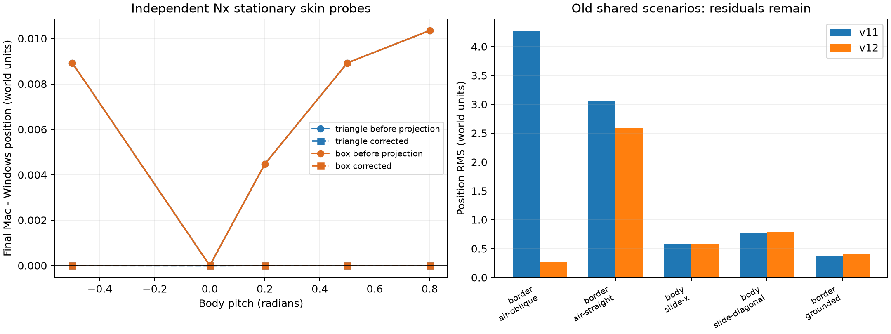

# MotorRock: контактная геометрия v12, 11 октября 2026

**Цель устранения всех расхождений активна и не достигнута.** Эталон — Windows / PhysX 2.8.4. Полная матрица содержит 608 сценариев / 255 864 шага на платформу; 132 новых сценария сохранены отдельно от среднего по прежним 476.

## Изменения рабочей Mac-сборки

- Для контакта кузова с треугольниками используется базовая обработка активных рёбер Jolt без скоростной подсказки. Это устраняет наклонную нормаль внутреннего шва на плоской стене; advanced collector прежде выбирал нормали вдоль шва. Остальные пары сохраняют штатный dispatcher.
- Nx skin учитывается как скаляр вдоль нормали контакта. Геометрический inset бокса уже представлен в форме Jolt; решателю передаётся разность между суммой source skins и проекциями реальных inset обоих тел. Расчёт учитывает вращение тела и внутренней формы, явные ширины skin и clamp тонких боксов.
- Дополнительный зазор используется и в скорости, и в позиционной коррекции; общий penetration slop не добавляется повторно для поддерживаемых source пар box/mesh/plane. Новые и кэшированные ограничения получают одинаковые параметры. Native Jolt сохраняет исходные значения по умолчанию.
- Профиль windows-source-v12.cfg включён по умолчанию. Ключи physx_contact_offsets и physx_mesh_edges позволяют независимо повторять абляции; прежние профили явно выключают оба изменения.
- В contact logging добавлены additional_separation и position_penetration_slop. Расчётные нормали source frame остаются диагностикой.

## Независимые измерения SDK

132 пробы собраны VC2008 SP1 с настоящим PhysX 2.8.4: source четыре колеса, LOCK_COM/contact modification, Z-up variable step, solver iterations=4, adaptive force=0. Материалы этих независимых проб отключают трение для изоляции нормального отклика. Основной Windows-стенд сохраняет оригинальное трение.

60 неподвижных проб включают пять углов, три body skins (.01/.025/.1), две толщины кузова и box/triangle стены. Windows подтверждает target = plane - support(full source box) + skin(body) + skin(other). Максимальная ошибка SDK относительно формулы — 5.1337776e-07. После исправления максимальная ошибка конечного положения Mac относительно SDK — 6.67e-06; допуск отдельного теста 2e-5. Прежняя ошибка для наклонного стандартного кузова достигала .01035261. Это проверка конечного положения, а не доказательство равенства переходного процесса.

72 пробы начального пересечения включают фиксированное и свободное вращение, шесть глубин и три скорости. Nx при глубине .25 за первый шаг снимает около 80% excess-overlap; при глубоком входящем ударе даже без трения остаётся отрицательная скорость. Frozen/free дают одинаковые линейные значения первого шага, но разные угловые момент и ориентацию. Нельзя заключать из этого, что Nx зануляет инерцию во всех фазах ограничения. Позиционная релаксация, остаточная скорость и угловая интеграция Jolt ещё отличаются.

Исходники независимых проб: tools/calibration/probes/contact-skin-v12. Сырые журналы и все эксперименты включены в архив аудита.

## Сравнение на общих 476 сценариях

| Взвешенный RMS | v11 | v12 |
|---|---:|---:|
| Положение | 0.369881701 | 0.29012808 |
| Скорость | 0.155543319 | 0.150407348 |
| Вращение, рад | 0.146164343 | 0.137879343 |
| Подвеска | 0.00567633554 | 0.00574746252 |

| Сценарий | RMS положения v11 | v12 | RMS вращения v11 | v12 |
|---|---:|---:|---:|---:|
| border-air-oblique | 4.2688363 | 0.26134845 | 0.68093187 | 0.13297048 |
| border-air-straight | 3.0603107 | 2.5839247 | 1.6179186 | 1.5594935 |
| border-front-air-straight | 2.9113247 | 2.6677286 | 1.6072583 | 1.4638876 |
| body-slide-x | 0.57825551 | 0.58191156 | 0.36159507 | 0.66353013 |
| body-slide-diagonal | 0.778669 | 0.78646641 | 0.33861651 | 0.42472871 |
| border-grounded | 0.36942601 | 0.40329424 | 0.039542889 | 0.040003581 |



Улучшение общего RMS не закрывает регрессии. Рост вращения body-slide-x/body-slide-diagonal и небольшой рост ошибки подвески остаются в очереди; исправление геометрического target само по себе не воспроизводит касательные импульсы и split/bias-фазы Nx. Полные показатели каждого случая доступны в report.json, без исключения ухудшившихся сценариев.

## Проверки

- 42 CTest и 15 Python проверок прошли. Независимый target-тест охватывает все 60 сочетаний угла, толщины и skin.
- Все samples прежних 476 Windows-сценариев сохранились точно. Старый профиль Mac воспроизводит все 476 прежних сценариев точно.
- 11 повторов Windows и 11 Mac-сценариев с contact logging совпали с полными captures точно.
- 132 независимые SDK-пробы повторили предыдущие 72+60 captures точно.
- 14 сценариев подписанного установленного приложения совпали с полным Mac-прогоном.
- Jolt patch проверен reverse/apply и повторным идемпотентным применением с побайтным сравнением.
- Строгая численная проверка оставляет 572/608 сценариев с различиями, включая малые float-отклонения. exact_parity.complete=false.

Игровые проверки:

```text
physics 0
track0 0
track16 0
track48 0
track64 0
```

Физический smoke-test и все четыре гонки (0/16/48/64, 600 кадров) прошли с исходным оружием и seed=42. Это ограниченная проверка исполнения и выживания; равенство всей гонки, ИИ и пикселей Windows этим не доказано.

## Продолжение цели

Следующий приоритет — позиционная релаксация Nx и взаимодействие bias-фазы с контактным трением и угловой интеграцией; затем устранение регрессий кузова и подвески, высокоскоростные комбинации мастерской и полные трассы. Графика меню, пиксели и ИИ этим численным этапом не сертифицированы. Caffeinate оставлен активным.

[Сборки и полный аудит v12](https://github.com/dmitrcher/rrr3d/releases/tag/physics-parity-v12-2026-10-11).
