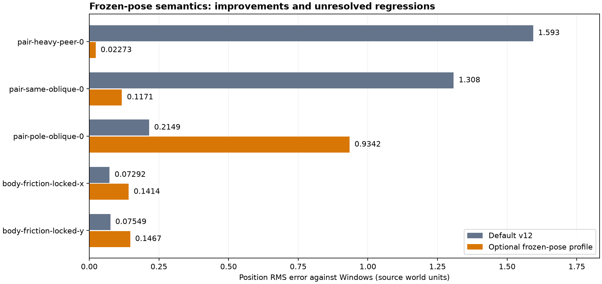

# Сверка физики v13: замороженное вращение и контактный solver

Цель устранить все расхождения остаётся **активной**. Полная физическая совместимость не достигнута. Численная политика по умолчанию остаётся v12; новый профиль `windows-source-v13-freeze.cfg` включается отдельно для исследования оставшихся контактов.

## Подтверждённое отличие

Mac ограничивал вращательные степени свободы замороженного кузова, меняя его эффективную массу при ударе. PhysX 2.8.4 описывает frozen actor как динамическое тело с восстановлением позы после симуляции (`Physics/include/Nxp.h`, строки 343–362). Свежий Windows-прогон с исходными материалами подтвердил: во всех 36 парных контактах frozen/free после первого шага совпадают координаты и линейная скорость; frozen-поза сохраняется, угловой момент равен нулю.

`physx_frozen_pose=1` сохраняет полную инерцию, после каждого solver step восстанавливает ориентацию относительно actor origin и обнуляет угловую скорость. Тест `source_frozen_pose` проверяет все 36 пар и отрицательный контроль старой политики; старый вариант отклоняется до 0.308305 в координатах/скоростях. Эти инварианты проверяют семантику блокировки; абсолютные результаты между движками ещё различаются.

## Полная матрица

**608 сценариев / 255,864 шагов** на платформу. RMS взвешен по количеству шагов во всех 608 сценариях; это не предыдущая общая выборка из 476 случаев.

| Параметр | Default v12 | Опциональный frozen-pose |
|---|---:|---:|
| Координаты, исходные единицы | 0.288853445 | 0.26385603 |
| Скорость, единицы/с | 0.150753539 | 0.143391897 |
| Вращение, рад | 0.137259038 | 0.137259038 |
| Ход подвески, исходные единицы | 0.00572152667 | 0.00572152667 |

Средний показатель координат улучшен примерно на 8.65%, скорости — на 4.88%. Замороженные парные удары улучшаются неравномерно:

| Сценарий | Координаты v12 RMS | Frozen-pose RMS |
|---|---:|---:|
| `pair-heavy-peer-0` | 1.59330203 | 0.0227269589 |
| `pair-same-oblique-0` | 1.30814352 | 0.11712571 |
| `pair-pole-oblique-0` | 0.214868393 | 0.934163225 |
| `body-friction-locked-x` | 0.0729190513 | 0.141404072 |
| `body-friction-locked-y` | 0.0754867181 | 0.146706672 |



Из-за ухудшений косого вертикального удара и трения новый режим не включён по умолчанию. Все 608 default captures совпадают с v12 по каждому численному sample. Незамороженные случаи опционального профиля совпадают с default; все синтетические результаты воспроизводят исходный эксперимент после удаления экспериментальных SDK-патчей.

При строгом сравнении различия остаются в **572 из 608 сценариев**, включая малые численные отличия. Ни средний RMS, ни отдельный первый шаг не подтверждают завершение цели.

## Отбракованные эксперименты

Полный кузов вместо уменьшенной коллизионной оболочки, единичная position-итерация, снятие ограничения коррекции глубоких пересечений, перенос friction frame на бордюры и изменение speculative bias проверены раздельно и в комбинациях. Некоторые варианты лучше воспроизводят стационарные пересечения или прямые удары, но ухудшают проезд неровностей либо косой/опорный контакт. Эксперимент пропуска position-фазы при отскоке нарушил права доступа Jolt к velocity и остановился на assert; он не входит в сборку. SDK восстановлен байт-в-байт до v12. Полные captures, модели, отрицательные результаты и контрольные суммы находятся в Audit-архиве.

## Проверки

- 43 CTest и 15 Python tests прошли.
- 72 Windows contact cases повторены в запущенной Windows 11 ARM64 / Parallels; все sample hashes совпали с эталоном v12.
- 16 Mac cases с контактной трассировкой повторили опциональную полную матрицу.
- Physics smoke и трассы 0, 16, 48, 64 по 600 кадров, seed 42, исходное оружие: exit 0 для default и опционального профиля.
- Установленное подписанное приложение повторило по 16 сценариев для default и опционального профиля, с включённой контактной трассировкой.
- Исторические журналы сжаты без потери данных; SHA-256 проверен после распаковки. После освобождения места Windows VM снова запущена.

## Запуск опционального профиля

```sh
RRR3D_CALIBRATION_PROFILE="$HOME/Applications/MotorRock-Calibration-Tools/profiles/windows-source-v13-freeze.cfg" \
  "$HOME/Applications/MotorRock-Calibration-Tools/MotorRock-PhysicsCalibration-macOS" frozen.jsonl all
```

В установленном наборе путь профиля — `~/Applications/MotorRock-Calibration-Tools/profiles/windows-source-v13-freeze.cfg`. Переменная применяется и к игровому приложению. `physx_frozen_pose` принимает строго 0/1, записывается в `calibration.profile`; прежние профили явно задают 0.

Следующие исправления должны согласовать bias/position-фазы, точки приложения импульсов и трение при косом контакте, затем переходные процессы подвески. Матрица не перебирает все сочетания мастерской и все игровые карты.

[Сборки и полный аудит v13](https://github.com/dmitrcher/rrr3d/releases/tag/physics-parity-v13-2026-10-11).
