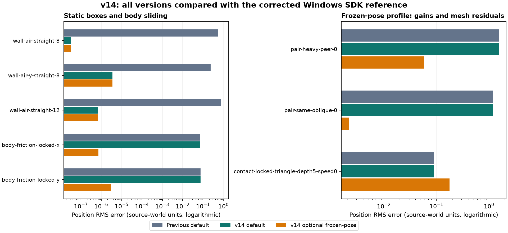

# Сверка физики v14: контакты кузова и исправленный Windows-стенд

Цель устранить все расхождения остаётся **активной**. Полная совместимость не достигнута. Новый static-box contact solver включён по умолчанию; восстановление замороженной позы остаётся отдельным профилем до исправления контактов с треугольниками.

## Исправленный эталон

В Windows-стенде присваивание `NxWheelShapeDesc` не копировало общие свойства второй машины: `NxShapeDesc::operator=` в исходном SDK намеренно ничего не делает. Терялись положения, материал и флаги колёс. Замена на copy construction с `vector::reserve(4)` сохраняет свойства и адреса описаний до создания actor. Реальная инерция peer теперь соответствует primary с учётом массы и записывается в `calibration.peer-description`. Исходная Windows-игра не изменена.

Эталон переснят в Windows 11 ARM64 / Parallels: **608 сценариев / 255 864 шага**. Все 574 сценария без второй машины повторили прежние sample hashes; изменились ровно 34 парных сценария. 12 независимых повторов исправленных пар совпали по каждому численному sample. Результаты пар из старых отчётов v6–v13 нельзя трактовать как сравнение одинаковых начальных условий: в новом отчёте обе настройки предыдущей Mac-версии заново сравниваются с исправленным Windows-эталоном.

## Контактная модель

Для зарегистрированных статических боксов восстановлены полные точки поверхности, порядок contact vertices и отдельное penetration error. Три импульса одной точки — нормаль и два касательных — вычисляются из одного состояния скорости, затем применяются вместе. Четыре biased прохода формируют скорость интеграции позы; дополнительный unbiased проход формирует публикуемую скорость. Warm start на этом пути выключен. Остальные контакты сохраняют прежний путь.

Генератор адаптирован из [NVIDIA PhysX 3.4 GuContactBoxBox.cpp](https://github.com/NVIDIAGameWorks/PhysX-3.4/blob/master/PhysX_3.4/Source/GeomUtils/src/contact/GuContactBoxBox.cpp), BSD-3-Clause; лицензия включена в исходники и app bundle. Совпадение с 2.8.4 подтверждается независимыми Windows-пробами, а не версией этого исходника. Патч pinned Jolt применяется после предыдущих патчей; свежая и повторная установка проверены. Cached contact layout не изменён.

Jolt допускает четыре solver points. Контактные patches с более чем четырьмя исходными точками пока используют прежнее сокращение; динамические пары и треугольники также требуют дальнейшей коррекции. Large island splitter выключен для согласованной финальной contact-фазы.

## Численные результаты

RMS взвешен по всем 255 864 шагам. Единицы координат — исходные единицы мира. Все столбцы используют один исправленный Windows-эталон.

| Параметр | Прежний default | v14 default | v14 frozen-pose, опционально |
|---|---:|---:|---:|
| Координаты | 0.280982316 | 0.261867791 | 0.231814227 |
| Скорость, единицы/с | 0.148851721 | 0.147470693 | 0.13920153 |
| Вращение, рад | 0.131188184 | 0.116474473 | 0.116474473 |
| Ход подвески | 0.00572152667 | 0.00572114171 | 0.00572114171 |

Default уменьшил RMS координат на 6.8%, вращения — на 11.2%. Изменились 66 Mac-сценариев; динамические пары и треугольники сохранили прежние численные samples. Максимальное ухудшение координат относительно прежнего default — порядка 2.6e-14, скорости — 2.5e-7. Однако в глубоком свободном пересечении RMS вращения ухудшился на 0.00107 рад; это остаётся в отчёте.

| Сценарий | Прежний default RMS координат | v14 default | v14 frozen-pose |
|---|---:|---:|---:|
| `wall-air-straight-8` | 0.520504566 | 3.38356323e-08 | 3.38356323e-08 |
| `wall-air-y-straight-8` | 0.233172578 | 3.5253035e-06 | 3.5253035e-06 |
| `wall-air-straight-12` | 0.775457983 | 6.94952885e-07 | 6.94952885e-07 |
| `body-friction-locked-x` | 0.0729190513 | 0.0729190513 | 7.24782921e-07 |
| `body-friction-locked-y` | 0.0754867181 | 0.0754867181 | 3.02501785e-06 |
| `pair-heavy-peer-0` | 1.53609986 | 1.53609986 | 0.0575885647 |
| `pair-same-oblique-0` | 1.19286654 | 1.19286654 | 0.00215339978 |
| `contact-locked-triangle-depth5-speed0` | 0.0886854528 | 0.0886854528 | 0.177348152 |

Опциональный профиль значительно улучшает парные удары и скольжение замороженного кузова, но ухудшает глубокое пересечение треугольника и отдельные наклонные mesh contacts. Поэтому default сохраняет `physx_frozen_pose=0`, а профиль `windows-source-v14.cfg` включает 1. Силовые масштабы в обоих вариантах равны единице.

При строгом сравнении остаются отличия в **572 из 608 сценариев**, включая малые численные остатки. В длинных wall runs остаётся накопленный angular drift; глубокий box impact после первого шага ещё расходится. Наибольшие оставшиеся ошибки координат связаны с бордюрами и приводом отдельных workshop presets; подвеска и кузовное трение на mesh также не завершены. Матрица не перебирает все комбинации мастерской и все карты.

## Проверки и сборки

- 44 CTest, включая 21 независимый Nx sample из шести траекторий и отрицательный контроль прежнего solver; 19 тестов сравнения.
- 18 Mac-сценариев повторены с contact tracing: samples идентичны полной матрице.
- Установленный подписанный app повторил 18 сценариев на каждом профиле; debug launcher проверен на четырёх сценариях и действительно выбирает v14 default.
- Physics smoke и трассы 0/16/48/64 по 600 кадров, seed 42, исходное оружие: exit 0 на обоих профилях.
- Новый Windows-стенд установлен в `C:\MotorRock\calibration`; прежний v12 exe сохранён отдельно.
- Mac: `~/Applications/MotorRock-Calibration.app` и `~/Applications/MotorRock-Calibration-Tools`.

Default профиль — `windows-source-v14-default.cfg`; опциональный — `windows-source-v14.cfg`. `physx_box_manifolds` принимает строго 0/1 и записывается в trace; прежние профили явно выключают новый путь. `launch-calibrated-game.sh` выбирает новый default и поддерживает `--physics-calibration` без изменения порядка её аргументов.

[Сборки и полный аудит v14](https://github.com/dmitrcher/rrr3d/releases/tag/physics-parity-v14-2026-10-11).
