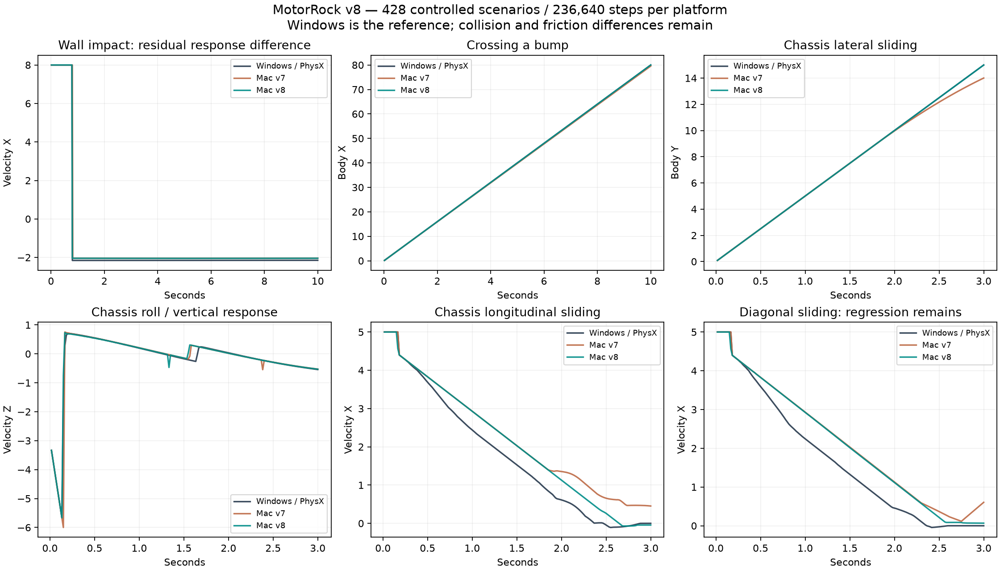

# MotorRock: физические контакты v8, 11 октября 2026

**Цель устранения всех расхождений активна и не достигнута.** Windows / PhysX 2.8.4 остаётся эталоном. Матрица расширена до 428 сценариев / 236 640 шагов на платформу.

## Изменения

- Дистанция speculative contact для inset-корпусов восстановлена до суммарного skin 0.05. Обычный удар при скорости 8 теперь начинается на шаге 47, как в Windows; v7 начинал на 48.
- У Nx-коробок отключён Jolt convex radius: SDK использует острые углы. Это улучшает контакт кузова с треугольной трассой и проезд через бугор. Инерция и силовые множители не менялись.
- Добавлены 8 ударов без пола/гравитации: прямые скорости 1, 2, 4, 8, 12, 24 и косые 4, 12.
- Windows пишет исходные контактные точки, оси и коэффициенты трения; обработчик GameCar остаётся исходным.
- Профили v6/v7 явно выключают новые переключатели для сравнения прежних геометрий.

## Сравнение на прежних 420 сценариях

| Взвешенный RMS | v7 | v8 |
|---|---:|---:|
| Положение | 0.17741535 | 0.17346513 |
| Скорость | 0.14423084 | 0.13871121 |
| Вращение, рад | 0.035418563 | 0.01866075 |
| Подвеска | 0.0057456629 | 0.0057286571 |
| Высота колёс | 0.0005508042 | 0.00070436904 |

Новые воздушные удары не добавлены к прежнему среднему: ошибки в них существенные и опубликованы отдельно. Все 420 прежних Windows-сценариев воспроизвелись с точным совпадением каждого sample.

| Пример | RMS положения v7 | RMS положения v8 |
|---|---:|---:|
| wall-hit | 1.5007539 | 1.4686459 |
| wall-oblique | 1.2009999 | 1.0891714 |
| body-slide-y | 0.43803481 | 0.025740673 |
| body-tilt-roll | 0.092581275 | 0.025913458 |
| bump-crossing | 0.24140695 | 0.0043459056 |



## Проверки и открытые ошибки

- 39 CTest и 14 Python проверок прошли. Независимый Nx-оракул закрепляет время первого удара при скоростях 4, 8, 12, 24; он не утверждает равенство импульсов.
- Повторные 27 Mac- и 13 Windows-сценариев совпали внутри платформ; полная Mac-матрица совпала с повтором после удаления экспериментального изменения порядка решателя. 13 сценариев профиля v7 воспроизвели прежние samples точно.
- Строгая сверка сообщает остаточные различия в 420/428 сценариях. Успешная сборка не означает физическую идентичность.
- Сохраняются сила и направление отдачи при ударе, вращение после удара и корпусное трение. На скорости 2 первое изменение скорости наступает в Mac на шаг позже; на скорости 1 временная граница совпадает, величина реакции отличается.
- В body-slide-diagonal RMS скорости вырос с 0.52597 до 0.61407; в body-tilt-roll RMS угла вырос с 0.00328 до 0.00720. Ход подвески на бугре ухудшился, хотя ошибка траектории снизилась с 0.24141 до 0.00435. Все регрессии перечислены в JSON по отдельным полям.
- Высокоскоростные варианты мастерской и прежние manticora / manticoraBoss расхождения остаются открытыми. Границы стенда ±500 могут влиять на самые быстрые машины; требуется отдельная проверка большой площадки.
- Перестановка решения normal/friction по каждой точке отвергнута: COM улучшился, но наклон кузова ухудшился до RMS положения 4.12. Производственный решатель восстановлен; сырые результаты опыта сохранены.
- Графическое smoke-тестирование не подтверждает равенство пикселей. Матрица обходится без коробки и ИИ, не покрывает все сочетания слотов или все игровые карты.

## Игровые проверки

```text
physics 0
track0 0
track16 0
track48 0
track64 1
```

Трассы 0, 16, 48 прошли по 600 кадров. На трассе 64 survival-проверка не прошла: отдельный повтор с журналом подтвердил гибель игрока от оружия соперников — Simple/Mine, урон 40 + 18 + 15, life 70 → 30 → 12 → −3. Физический урон кузова не вызвал эти три события. Исходные правила урона не отключались; этот результат не отмечается успешным.

[Сборка и полный аудит v8](https://github.com/dmitrcher/rrr3d/releases/tag/physics-parity-v8-2026-10-11).
