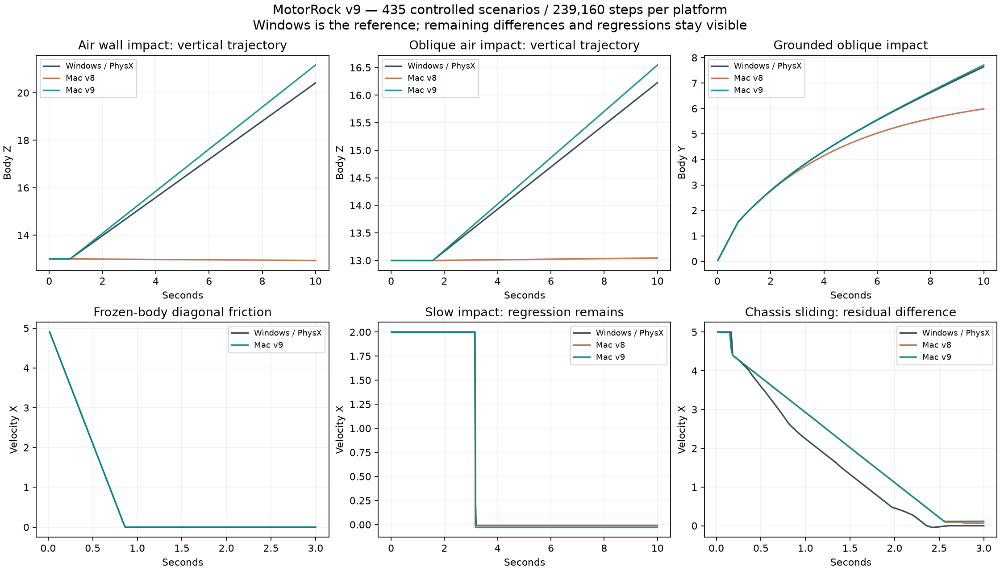

# MotorRock: трение и кузовные контакты v9, 11 октября 2026

**Цель устранения всех расхождений активна и не достигнута.** Windows / PhysX 2.8.4 остаётся эталоном. Матрица: 435 сценариев / 239 160 шагов на платформу.

## Исправления

- Изолированный SDK-тест с фиксированным вращением подтвердил независимые пределы двух касательных импульсов. При диагональном движении каждая ось в Windows замедляется на 5.80001235; общий эллиптический предел Jolt давал 4.10121918. Независимые пределы Mac дают 5.79999804. Это проверено отдельным CTest, без подгонки управляющих сил.
- Для четырёх контактов двух коробок применён порядок обхода грани, выбранный по независимым воздушным ударам и проверенный общей матрицей. Это измеренное приближение к закрытому решателю Nx, а не утверждение о внутреннем устройстве SDK. Порядок контактов треугольной трассы не менялся.
- Новые переключатели physx_independent_friction и physx_box_contact_order принимают только 0/1. Исторические v6/v7/v8 отключают оба; профиль v8 воспроизводится точно на 13 core-сценариях.
- Добавлены четыре теста кузовного трения с фиксированным вращением, удар с обратным боковым движением и два удара о перпендикулярную стену. Фиксация вращения больше не приводит к инверсии нулевой матрицы инерции и NaN.
- RRR3D_CONTACT_POINTS=1 пишет physics.contact-manifold: входные точки Jolt, центры, нормаль, касательную ось, коэффициенты и режимы контакта. Порядок решения после сортировки не выдаётся за исходный manifold. Временные метки сохраняются.

## Измерения на общих 428 сценариях

| Взвешенный RMS | v8 | v9 |
|---|---:|---:|
| Положение | 0.92053918 | 0.17721223 |
| Скорость | 0.21314892 | 0.13719162 |
| Вращение, рад | 0.20483462 | 0.051847643 |
| Подвеска | 0.0056702595 | 0.0056582522 |
| Высота контакта колёс | 0.00069718874 | 0.00069718874 |

В общей матрице RMS положения снизился на 80.75%, скорости на 35.63%, угла на 74.69%. Эти средние не подтверждают каждый эффект. Все регрессии и величины каждого сценария записаны отдельно.

| Сценарий | RMS положения v8 | RMS положения v9 |
|---|---:|---:|
| wall-hit | 1.4686459 | 0.26053801 |
| wall-oblique | 1.0891714 | 0.054814877 |
| wall-air-straight-8 | 4.4405641 | 0.52050457 |
| wall-air-oblique-4 | 1.72065 | 0.17247792 |
| wall-air-straight-1 | 0.061539285 | 0.078188189 |
| wall-air-straight-2 | 0.30993304 | 0.39402359 |
| body-slide-diagonal | 0.77652141 | 0.778669 |



## Проверки и ограничения

- 40 CTest и 14 Python проверок прошли. Pinned SDK patch проверен reverse/apply и повторным применением без изменений трёх файлов.
- Все 428 прежних Windows-сценариев сохранили каждый sample точно. Полная Mac-матрица 435 совпала с предварительным вариантом после восстановления решателя. Повторы 19 Mac/19 Windows совпали внутри платформ. 13 установленных Mac-сценариев совпали с окончательной матрицей; codesign проверен.
- Включение журнала manifold не изменило samples двух контрольных сценариев.
- Строгая сверка оставляет 427/435 сценариев с различиями, включая малые численные отклонения. Код 0 обычного compare означает завершение анализа; exact_parity.complete=false.
- Прямые воздушные удары со скоростями 1 и 2 ухудшились: RMS положения 0.06154→0.07819 и 0.30993→0.39402. Для скорости 2 сохраняется запаздывание контакта на один шаг.
- Диагональное скольжение незакреплённого кузова: RMS угла 0.29892→0.33862. Остаточные вращение, отдача и геометрия контактов ещё требуют исправлений. В фиксированных тестах x/y SDK создаёт небольшую поперечную скорость; независимый предел решает диагональное торможение, но не всю задачу.
- Полный кузов без inset и speculative-distance ухудшил body-slide-y: RMS положения 0.02574→0.26980. Последовательный расчёт двух касательных импульсов ухудшил несколько воздушных ударов. Оба эксперимента отвергнуты; сырые результаты сохранены.
- Инерция, подвеска, привод и ранее внесённые правила Nx сохранены. Сохраняются переходные ошибки подвески, высокоскоростных пресетов и отдельных моделей; границы стенда ±500 требуют проверки для быстрых машин.
- Матрица пока не покрывает столкновения двух автомобилей, все сочетания мастерской, ИИ, полные карты, оружие или равенство пикселей. Для пары двух анизотропных автомобильных материалов требуется отдельный SDK-тест вторичного коэффициента.

## Игровые проверки

```text
physics 0
track0 0
track16 0
track48 0
track64 1
```

На трассе 64 проверка выживания остаётся неуспешной. В повторе seed=42 игрок получил исходный урон оружия 40, 18 и 18: life 70→30→12→−6. Среди повреждений игрока нет PhysicalTouch (3) или DeathPlane (4). Это объясняет конкретную гибель; равенство физики/ИИ таким журналом не подтверждается.

[Сборка и полный аудит v9](https://github.com/dmitrcher/rrr3d/releases/tag/physics-parity-v9-2026-10-11).
